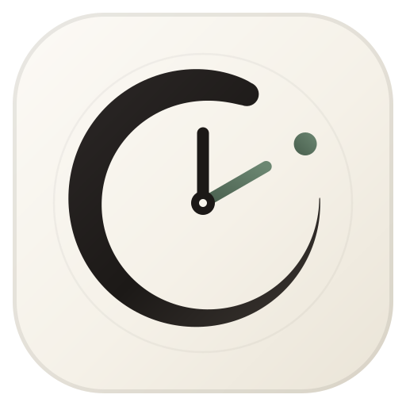

<p align="center">
  
</p>

<h1 align="center">Auto Tab Closer</h1>

<p align="center">
  A quiet, Zen-minimalist Chrome extension (Manifest V3) that automatically closes inactive browser tabs and Chrome web apps (PWAs) once they pass a configurable stillness timer.
</p>

---

## Highlights

- **General Inactivity Timer (Default: 120 minutes)** — Set any timeout from `1` minute up to `30` days (`43,200` minutes) or switch instantly with presets (`15m`, `30m`, `1h`, `2h`, `4h`, `8h`). Synced across Chrome via `chrome.storage.sync`.
- **Covers Tabs & Standalone Web Apps (PWAs)** — Tracks both tab switches and window focus changes (`chrome.windows.onFocusChanged`), so idle single-tab Chrome app/PWA windows in the background also close automatically.
- **Zen Minimalist UI with Light & Dark Mode** — Calm Washi (light) and Sumi (dark) themes that follow your system preference by default and toggle in one click from the header.
- **Thoughtful Protection Rules**:
  - Never closes the active tab in your currently focused window.
  - **Pinned tabs** — protected by default.
  - **Audible tabs** — protected by default so music, calls, or videos keep playing.
  - **Active tab in background windows** — off by default so idle app/PWA windows close; toggle on if you prefer keeping one active tab per unfocused window.
  - **Excluded sites** — allowlist exact domains or subdomains (e.g., `google.com` covers `mail.google.com`), plus a 1-click `+ <current site>` shortcut.
- **Live Countdown & Recovery**:
  - Inspect remaining time for every open tab and reset individual timers on demand.
  - Reopen any recently auto-closed tab in one click from the **Closed** tab.
  - Pause/resume auto-closing anytime with an `OFF` toolbar badge indicator.
- **Zero-Dependency & Privacy-First** — Built with vanilla ES modules, zero external requests, zero content scripts, and no broad `<all_urls>` host permissions.

---

## Installation (Load Unpacked in Chrome)

1. Clone this repository:
   ```bash
   git clone https://github.com/bajpai244/auto-tab-closer.git
   ```
2. Open `chrome://extensions` in Chrome (or any Chromium-based browser).
3. Enable **Developer mode** in the top-right corner.
4. Click **Load unpacked** and select the cloned `auto-tab-closer` folder.
5. Pin **Auto Tab Closer** to your toolbar and click it to configure your timer (defaults to **120 minutes**).

---

## How It Works

Chrome Manifest V3 service workers are ephemeral, so Auto Tab Closer persists all state safely across worker restarts:

1. **Activity Tracking** — `src/background.js` listens to `tabs.onActivated`, `tabs.onCreated`, `tabs.onRemoved`, active-tab navigation in `tabs.onUpdated`, and `windows.onFocusChanged`. Whenever you switch away from a tab or unfocus a window, the exact timestamp is stamped in `chrome.storage.local` so inactivity starts from the moment you left it. Background page title/status updates never falsely reset a tab's timer.
2. **Periodic Sweeps** — A `chrome.alarms` schedule runs every minute to evaluate open tabs through the pure logic in `src/core.js`, closing any unprotected tab whose elapsed inactivity reaches your configured threshold.
3. **Recovery Log** — Closed tabs are saved to `closedHistory` in `chrome.storage.local` (up to the 30 most recent) so anything closed can be reopened with a single click.

### Permissions Used

| Permission | Purpose |
| --- | --- |
| `tabs` | Track tab activity, inspect pinned/audible/active state, and close expired tabs. |
| `alarms` | Run reliable 1-minute background sweeps in a Manifest V3 service worker. |
| `storage` | Sync settings across Chrome (`storage.sync`) and persist per-browser activity timestamps & closed history (`storage.local`). |

---

## Project Structure

```text
auto-tab-closer/
├── manifest.json           # Chrome Extension Manifest V3 definition
├── icons/                  # Zen SVG source and 16/32/48/128 PNG toolbar icons
├── src/
│   ├── core.js             # Pure timer evaluation, protection rules, domain matching
│   ├── background.js       # MV3 service worker, event tracking, alarm sweeps
│   ├── popup.html          # Popup markup
│   ├── popup.css           # Zen light (Washi) & dark (Sumi) theme styles
│   └── popup.js            # Popup UI controller & theme persistence
├── tests/
│   ├── core.test.js        # Unit tests for core evaluation & settings normalization
│   └── background.test.js  # Service worker integration tests with mocked Chrome APIs
└── package.json            # ES module config and test script
```

---

## Testing

Requires Node.js 20+ (uses Node's built-in `node:test` runner with zero external packages):

```bash
npm test
```
